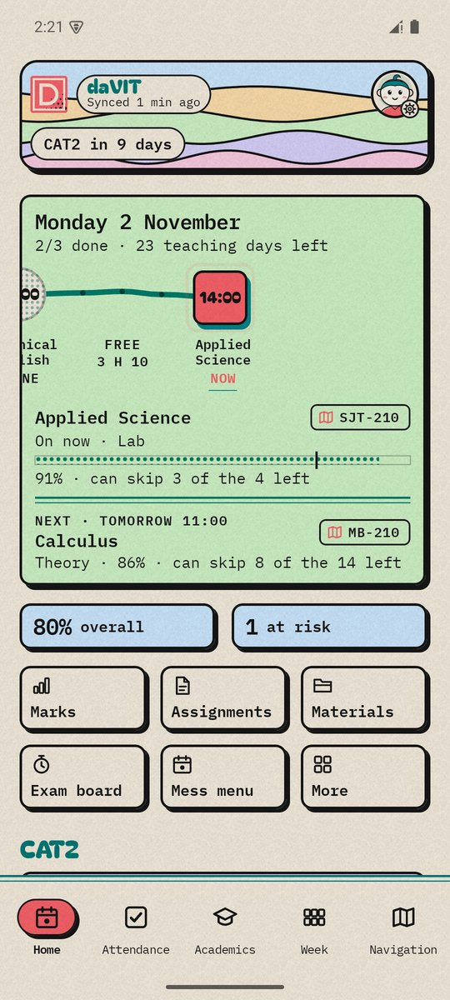
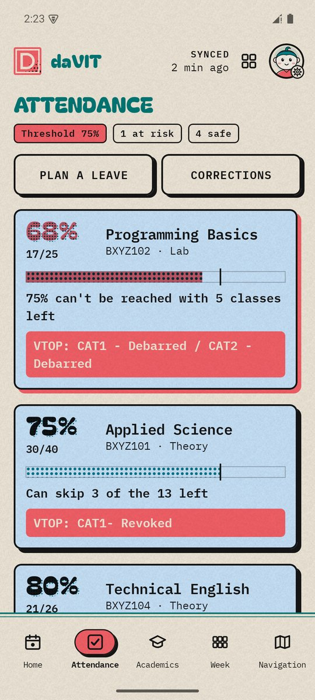
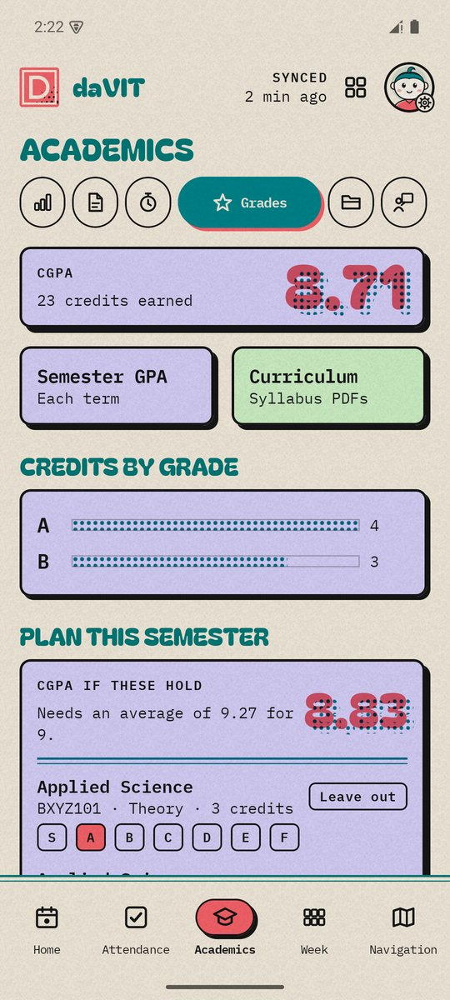
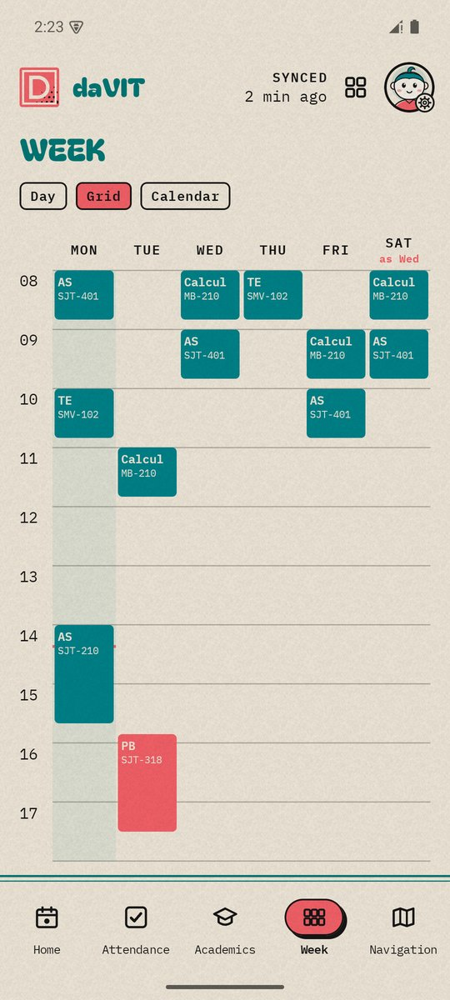
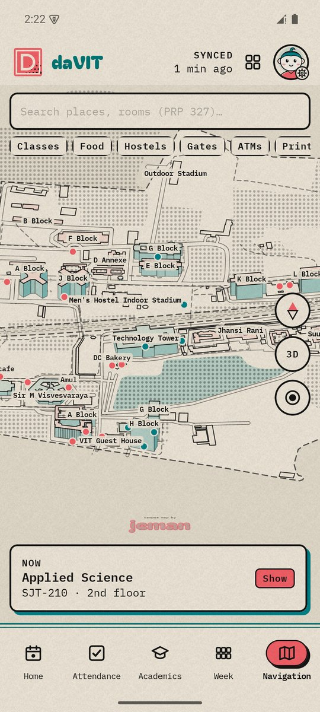
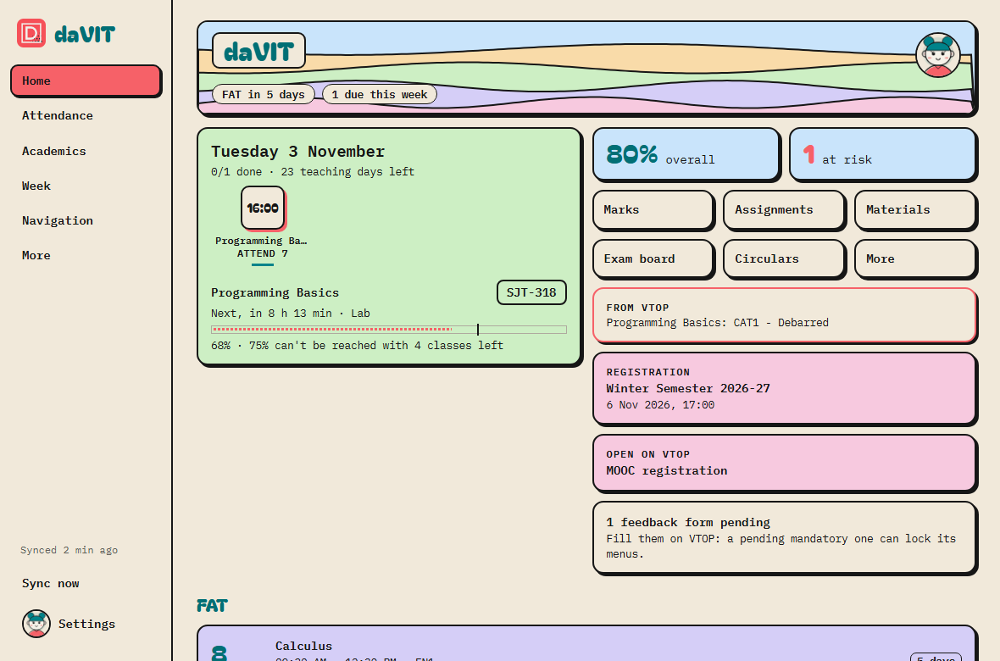

<div align="center">


# daVIT

**VTOP, without the waiting.** Attendance, classes, marks and the campus map for VIT students, on your phone and your computer.

[](https://github.com/medriid/davit/releases/latest)
[](https://github.com/medriid/davit/releases)
[](LICENSE)

[](https://github.com/medriid/davit/releases/latest)

Android 8+ · Windows, macOS and Linux · only download it from [releases](https://github.com/medriid/davit/releases)

<br>







<br><br>



</div>

## What it does

- **Home**: today's classes, your next one and what's due, all on one screen.
- **Attendance**: how many you can skip, what a leave will cost, and fixes for wrong absences.
- **Academics**: marks, grades, CGPA, the exam board and a planner for this semester.
- **Assignments and materials**: scan and upload assignments; read course PDFs in the app or keep them offline.
- **Your week**: a list, a grid or the calendar, with free time shared with friends by QR code.
- **FFCS**: set your rules and get the best clash-free timetables.
- **Campus map**: find any room and walk there.
- **Faculty**: student reviews from No8AM, and open research projects.
- **Alerts**: low attendance, new marks, deadlines, circulars and registrations as they open.
- **Requests**: hostel leave, night slips, bonafide, course feedback and paper seeing, shown whole before anything is sent.
- **Yours**: Classic or Editorial, any colours, a mascot and your own display card.

## Private by design

Your password and data stay on your device, encrypted. There's no server, account or analytics. daVIT only changes anything on VTOP after you confirm on screen, and never touches payments or registration. Signing out erases everything. More in [the security model](docs/06-security-and-encryption.md).

<details>
<summary>Installing on a phone</summary>

Open the APK and allow installs from your browser when Android asks. After that, daVIT offers new versions itself.

On OnePlus, Oppo, Realme and Xiaomi phones, let it run in the background (Settings → Sync) so alerts arrive.

</details>

<details>
<summary>Installing on a computer</summary>

The installers aren't signed with a paid certificate, so your system warns you the first time.

- **Windows**: run the `-setup.exe`. If SmartScreen appears, choose More info, then Run anyway.
- **macOS**: open the `.dmg` and drag daVIT to Applications, then right-click it and choose Open.
- **Linux**: install the `.deb`, or make the `.AppImage` executable and run it. It needs a keyring such as GNOME Keyring for your password.

Closing the window leaves daVIT in the tray so alerts and syncs keep coming; turn that off in Settings. A computer has no home screen widgets or GPS, so the tray icon shows your next class, classes export as a calendar file, and Find me on the map is only as good as your computer's guess.

</details>

<details>
<summary>Building from source</summary>

The phone app needs JDK 17 and the Android SDK (API 35):

```bash
cd android && ./gradlew assembleDebug
```

The desktop app is [Tauri](https://tauri.app), so it needs Rust and Node:

```bash
cd desktop && npm ci && npx tauri build
```

The captcha model and slot timetable aren't in this repository, so a build from source runs but can't sign in. See [the captcha solver](docs/05-captcha-solver.md) and [VTOP's endpoints](docs/04-vtop-api-reference.md).

</details>

## Credits

Campus map by [Jeman](https://www.linkedin.com/in/jemankalita/) (MIT) · map data © [OpenStreetMap](https://www.openstreetmap.org/copyright) contributors · faculty reviews from [No8AM](https://no8am.site) · fonts Bagel Fat One and IBM Plex Mono (OFL)

[Apache-2.0](LICENSE). Not affiliated with VIT. [Issues](https://github.com/medriid/davit/issues) for bugs and ideas.
