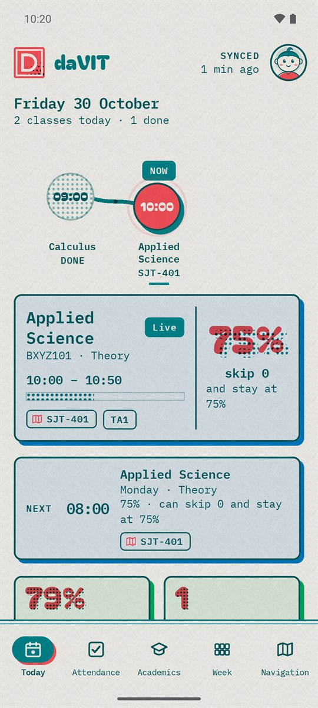
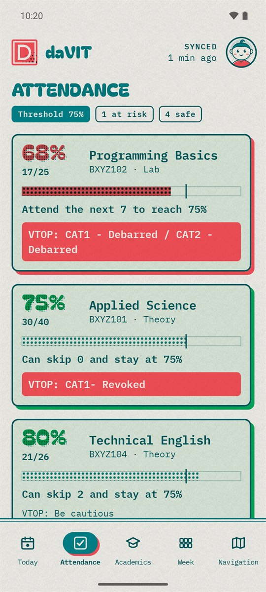
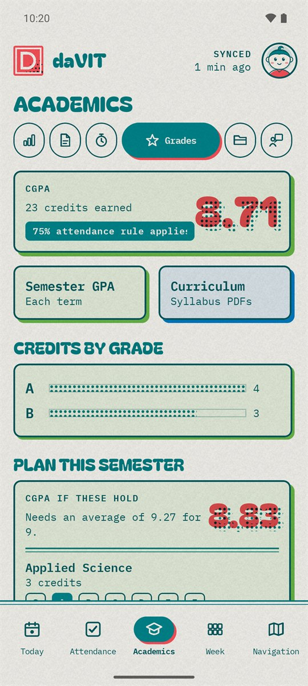
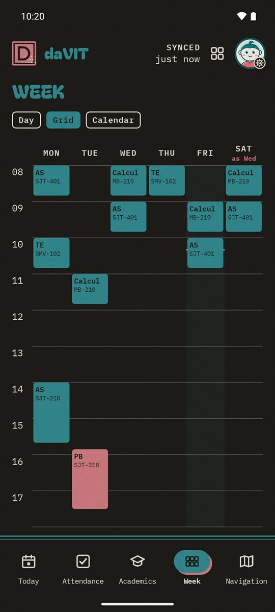
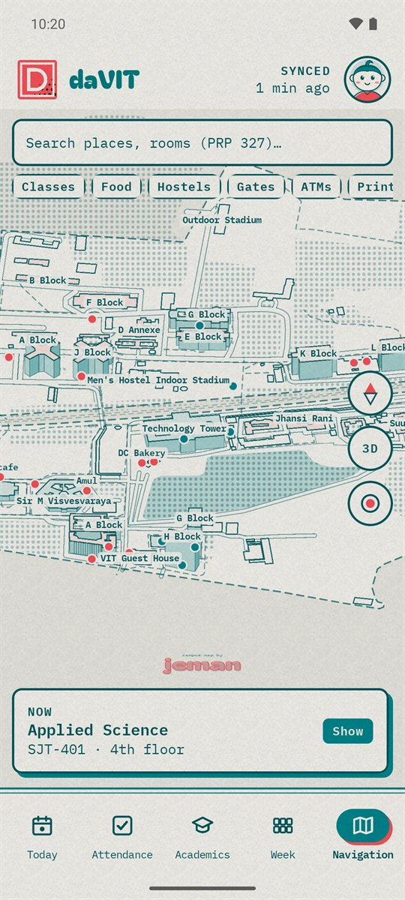

<div align="center">


# daVIT

### VTOP, without the waiting
Attendance, classes, marks and the campus map for VIT students, printed in two inks.

[](https://github.com/medriid/davit/releases/latest)
[](https://github.com/medriid/davit/releases)
[](https://github.com/medriid/davit/actions/workflows/release.yml)
[](LICENSE)

## Download

[](https://github.com/medriid/davit/releases/latest)

**Android** 8+ · updates itself

*Only download daVIT from this repository's [releases](https://github.com/medriid/davit/releases).*

<br>







## Features

<div align="left">

* **Today**: the class on now and next with its room, what's due, and what changed since you last looked.
* **Attendance** sorted by risk: how many you can skip or must attend to stay at 75%, and VTOP's debarment remarks.
* **Academics**: marks, assignments, exams, grades and CGPA, with a planner for this semester.
* **Assignments end to end**: download the question paper, scan pages into a PDF, and upload it from your phone.
* **Course materials** by module, kept offline, with a search that forgives typos.
* **Your week** as a list, a grid or the academic calendar, with holidays and exam dates.
* **Campus map**: find a block, a mess or a room (PRP 327), and walk there from where you are.
* **The rest of VTOP**: hostel leave, club events, messages, receipts, curriculum, feedback and more.
* **Alerts you set up**: low attendance, a reminder before class, new marks and deadlines; plus a home-screen widget.
* **Signs in by itself.** The captcha is solved on your phone, so a refresh takes seconds.

</div>

## Private by design

<div align="left">

* Your password and data stay on your phone, encrypted with a key Android keeps. No server of ours, no accounts, no analytics.
* It writes to VTOP only after you've confirmed on screen. Payments, registration and password changes are blocked in code.
* Besides VTOP, it only fetches the campus map and checks GitHub once a day for a new release. Neither sends anything about you.
* Signing out erases everything it stored, key included. More in [the security model](docs/06-security-and-encryption.md).

</div>

<details>
<summary>Installing</summary>
<div align="left">

* Open the APK and allow installs from your browser when Android asks.
* After that, daVIT downloads new releases by itself and asks before installing (Settings → About).
* On OnePlus, Oppo, Realme and Xiaomi phones, let daVIT run in the background (Settings → Sync) so syncs and alerts arrive.

</div>
</details>

<details>
<summary>Building from source</summary>
<div align="left">

Needs JDK 17 and the Android SDK (API 35).

```bash
cd android && ./gradlew assembleDebug
```

The captcha model and slot timetable aren't in this repository, so a build from source runs but can't sign in; see [the captcha solver](docs/05-captcha-solver.md). Releases are built and signed by [GitHub Actions](.github/workflows/release.yml) from the tagged commit.

`android/` is the app (Kotlin, Compose; `core` is plain JVM and tests on a laptop) · `web/` a small Flask build of the same engine · `docs/` the [VTOP endpoints](docs/04-vtop-api-reference.md), captcha solver and security model

</div>
</details>

## Questions and help

[Issues](https://github.com/medriid/davit/issues) for bugs and ideas · [Releases](https://github.com/medriid/davit/releases) for what's new

### Credits

Campus map by [Jeman](https://www.linkedin.com/in/jemankalita/) (MIT) · map data © [OpenStreetMap](https://www.openstreetmap.org/copyright) contributors · fonts Bagel Fat One and IBM Plex Mono (OFL)

### License

[Apache-2.0](LICENSE). daVIT is not affiliated with VIT.

</div>
